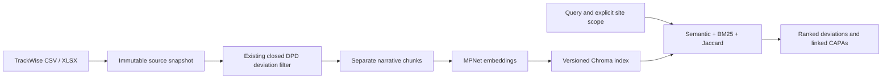

# CAPA.AI MATCH backend

Docker: [independent image, one-command startup and storage setup](DOCKER.md).

Independent FastAPI service for finding similar historical deviations. The retained MPNet/Chroma, BM25 and Jaccard logic is packaged here with no imports from the old platform or another CAPA backend. The common React frontend remains a separate project; its MATCH design is still pending.

Related repositories: [AUTHOR backend](https://github.com/rahul-jha-tfs/capa-ai-author-backend) and [common frontend](https://github.com/rahul-jha-tfs/capa-ai-frontend).

## Run locally

Python 3.11, 64-bit. This workstation has a configured independent environment, source snapshot, MPNet cache and matching index.

```powershell
.\Start-Match.ps1
```

API documentation: http://127.0.0.1:8102/docs. Health: `/api/v1/match/health`. Index readiness and coverage: `/api/v1/match/index`.

On a new machine, first install Git LFS and fetch `data/sources/trackwise_records.csv` with `git lfs pull`, then:

```powershell
.\Setup-Match.ps1
# Or supply another CSV/XLSX: .\Setup-Match.ps1 -Source C:\data\export.xlsx -Sheet Sheet1
```

Provide the MPNet model cache separately in `data/models/huggingface`. Model and index files are excluded from Git. With a populated cache, build the source-compatible index:

```powershell
.\.venv\Scripts\python.exe -m capa_match.build
```

For a first model download, set `HF_HUB_OFFLINE=0` and `TRANSFORMERS_OFFLINE=0` in local `.env` before building; return them to `1` for offline serving. No mock fallback is used for a real index. A cold first search loads the model and takes longer. A new source requires an index rebuild and service restart.

## Process and retained behavior



The configured source has 19,643 accepted records. The supplied local index covers 4,292 eligible deviations, 24,440 chunks and 96 linked CAPAs across 25 sites. Description and conclusion are indexed as separate fields, with 500-character windows and 50-character overlap. Ranking retains `0.70 * semantic + 0.20 * BM25 + 0.10 * Jaccard`. Scores are ranking signals, not percentages of correctness.

Select either one allowed site or `all_sites: true`; combined retrieval still respects `MATCH_ALLOWED_SITES_JSON`. Results preserve the exact source IDs, original indexed text, matched field, component scores and linked CAPA metadata. A source/index snapshot mismatch refuses service rather than returning stale results.

| Endpoint | Purpose |
|---|---|
| `GET /api/v1/match/index` | Coverage, runtime, source version and readiness |
| `GET /api/v1/match/sites` | Allowed searchable sites |
| `POST /api/v1/match/search` | Site-specific or all-sites retrieval; `top_k` 1-50 |
| `GET /api/v1/match/matched-records/{pr_id}?site=...` | Complete indexed record and linked CAPAs |
| `GET /api/v1/match/source` | Source metadata and row accounting |

Example search body:

```json
{"query":"HPLC bracket standard failed system suitability","all_sites":true,"top_k":10}
```

Generic unscoped source-record browsing is deliberately unavailable in MATCH. Its own record endpoint applies the site boundary. The local allowlist is server configuration, not identity-derived enterprise authorization.

## Index management and layout

`python -m capa_match.build --help` retains division, site, limit, model/runtime/batch, chunk size/overlap, repeatable text-field and explicit mock options. Use `--rebuild` to apply changed build settings. Previous generations remain available. The builder rejects ambiguous source identifiers and unrelated CSVs before replacing an index.

```text
src/capa_match/       API, source identity adapter, configuration and index build
src/match_v1/         Retained retrieval engine and compatibility CLI/API
src/capa_match/infrastructure/  Service-owned import, storage and source contracts
scripts/             Real-service smoke checks
tests/              Offline contracts plus opt-in real model tests
data/sources/       Included source CSV through Git LFS; generated snapshots ignored
```

## Verify and deploy

```powershell
.\.venv\Scripts\python.exe -m pytest -q
.\.venv\Scripts\python.exe -m pip check
.\.venv\Scripts\python.exe scripts/verify_local.py
```

The optional heavy suite is enabled with `MATCH_RUN_INTEGRATION=1`. It exercises real persisted Chroma and MPNet runtimes. Offline tests use clearly fictional fixtures and do not establish model quality. This service makes no OpenAI API calls.

See [feature parity](FEATURE_PARITY.md), [verification](VERIFICATION.md) and [Databricks deployment steps](DEPLOYMENT.md). No GitHub push or Databricks deployment is performed by local setup.
