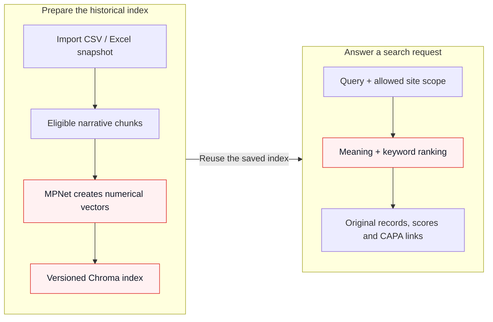

# CAPA.AI | MATCH backend

**Find historical deviations that resemble a new problem, with the source records available for inspection.**

MATCH is an independent FastAPI search service. It combines similarity in meaning with keyword overlap, respects the configured site scope, and returns ranked records with their original IDs and linked CAPAs. Embeddings run locally. Optional AI assistance uses the configured OpenAI-compatible Responses endpoint for query interpretation, candidate relevance review and cited evidence overviews.

A deviation is a recorded departure from an expected process. CAPA means corrective and preventive action.

| At a glance | Details |
|---|---|
| Runtime | Python 3.11, 64-bit; FastAPI |
| Local API | http://127.0.0.1:8102 |
| Interactive API docs | http://127.0.0.1:8102/docs |
| Docker image | `capa-ai-match:local` |
| Current integration | Common frontend MATCH workspace; AUTHOR retains its existing search contract |

[Architecture](#how-match-works) / [Setup](#run-locally) / [Search](#try-a-search) / [Storage](#data-and-index-lifecycle) / [Troubleshooting](#troubleshooting) / [Deployment](#deployment)

## Where this fits

| Repository | Responsibility | Port |
|---|---|---|
| [MAP backend](https://github.com/rahul-jha-tfs/capa-ai-map-backend) | Group historical deviations into patterns | 8101 |
| **This repository: MATCH** | Retrieve similar historical records | 8102 |
| [AUTHOR backend](https://github.com/rahul-jha-tfs/capa-ai-author-backend) | Investigation drafting; optional MATCH search over HTTP | 8103 |
| [Common frontend](https://github.com/rahul-jha-tfs/capa-ai-frontend) | Browser interface for MAP and MATCH | 8100 |

Services use copies of the same versioned CSV/XLSX export, imported into independent snapshots. They do not require sibling source folders, a shared Python package or a live TrackWise connection. Compare snapshot IDs when connecting services; importing new data into one service does not update the others automatically.

## How MATCH works

### Search experiment

The search-first update keeps filters collapsed behind a labelled **Filters** button, with selected criteria visible outside the panel. Smart searches use both original and clarified wording. Explicit opened years/ranges, criticality and unique site names become visible hard constraints; selected controls take precedence. A true filter-only request such as “show all Critical deviations in 2025 and 2026” browses those records with complete counts rather than ranking the word “deviations.”

For natural language, original/clarified results are combined using reciprocal rank fusion (constant 60), then up to 20 candidates can be reviewed by the LLM for event relevance. Any displayed relevance quote must occur in that candidate's supplied source text. Plain IDs, quoted phrases, blank browsing and explicit Keywords/Exact/Meaning modes retain their predictable retrieval paths. Existing AUTHOR requests remain on the original contract.

The independent **Evidence overview** summarizes up to six returned records in three short cited lines. The LLM synthesizes patterns/findings; the CAPA line is calculated from actual retained links and statuses, so narrative mentions cannot become invented links or completion claims. Citations are restricted to reviewed deviation IDs; CAPA IDs cannot replace source references. Longer drafts receive at most one evidence/length revision, without truncating sentences. This is an excerpted sample, not a full-population analysis or a current-case conclusion. Results remain usable while the overview prepares or when AI is unavailable.

To enable AI, set server-side `OPENAI_API_KEY`, `OPENAI_BASE_URL` (locally `https://api.openai.com/v1`), `MATCH_ASSIST_ENABLED=1`, `MATCH_ASSIST_MODEL` (query interpretation, default `gpt-4.1-mini`), `MATCH_REVIEW_MODEL` (relevance/overview, default `gpt-4.1`) and optionally `MATCH_ASSIST_TIMEOUT_SECONDS` (default 30) in ignored `.env`. Leave the key empty or set `MATCH_ASSIST_ENABLED=0` for local retrieval only. Use an endpoint authorized for the source data: natural-language queries, up to 20 limited candidate excerpts for relevance review, and up to six result excerpts/CAPA details for the overview are sent there with `store:false`. Credentials stay on the backend. Normal searches never send the complete export or rebuild embeddings.

Planning, relevance and successful overview results have bounded in-memory caches. Opaque overview IDs expire after 15 minutes and are invalidated by source/site-authority changes. The overview endpoint accepts only the server-issued search ID, never client-supplied evidence. No source data or cases are written. Review the source before using AI interpretations; a labelled evaluation set is still needed to measure retrieval accuracy.

Branch `codex/match-search-experiments-20261119` adds structured exploration to the existing index. Use it with the same branch of the frontend at `/match`.

- Filter by site, opened year(s), source criticality, DR type, responsible department, inclusive opened-date range and retained CAPA links. Multiple values within one field mean OR; different fields mean AND. Blank search browses the filtered records, newest opened first.
- Smart mode recognizes exact deviation IDs, short equipment/document references and short keywords. Identifier searches preserve every digit and leading zero while tolerating separators, for example `MFG859` / `MFG-859`. Unknown identifiers return no matches instead of unrelated similar records. Use Keywords to search a numeric equipment or batch reference rather than an exact deviation ID.
- Keywords require all words; quotation marks or Exact phrase require a literal phrase. These search full retained description, conclusion, recorded title and source investigation text where available. Investigation text is loaded read-only from the same source snapshot; it has not been added to semantic vectors.
- Longer descriptions use meaning and keywords; Meaning mode compares broader wording without hard identifier constraints. Filters constrain retrieval before ranking. Experimental relevance uses 70% narrative rank and 30% recorded event-title meaning among up to 50 retrieved candidates. Narrative hybrid rank retains its original 70/20/10 formula. Scores prioritize review; they are not correctness or recurrence probabilities. Literal and browse results have no similarity score.
- Filter counts describe the indexed population, not the entire source export. MATCH now indexes usable deviations across DPD, DSD, CTD and Global and retains all source workflow statuses. Search defaults to completed (Closed - Done) investigations; ongoing and cancelled records have separate controls. Source totals also include CAPAs and records without searchable text. CAPA completion means a retained linked CAPA marked Closed - Done; it does not establish effectiveness.

`POST /api/v1/match/facets` supplies authorized filter choices and counts. Send an explicit `mode` (including `auto`) to opt into the explorer API; add `assist:true` for query assistance and an overview ID. Existing narrative clients that omit `assist`, `mode`, `filters` and `offset` retain the original hybrid ranking. `/index` reports local model warm-up separately; browsing and literal retrieval do not need model inference. Cached MPNet artifacts load offline first. No new dependency, source import or index rebuild is required. Optional AI calls are billed by the configured provider. See [API details](docs/API.md).

An **index** is a prepared, searchable representation of historical records. Build it when provisioning or changing source data; ordinary searches reuse it.



| Part | Current behavior | In plain terms |
|---|---|---|
| Embeddings | `sentence-transformers/all-mpnet-base-v2` | Compare the meaning of text |
| Runtime | ONNX FP32 by default | Run the model locally on CPU |
| Text preparation | Description and Conclusion separately; 500-character windows, 50-character overlap | Search long narratives while preserving field identity |
| Vector storage | Chroma with a versioned manifest | Reuse an index tied to its source |
| Legacy narrative ranking | 70% semantic + 20% BM25 + 10% Jaccard | Explorer also compares recorded event titles as described above |
| Site scope | One allowed site or all configured allowed sites | Keep retrieval within the chosen boundary |

Scores are ranking signals, not percentages of correctness. CAPA links come from source relationships. The local site allowlist is server configuration; enterprise user-based access control requires deployment configuration.

## Run locally

Install Git for Windows and Docker Desktop, and start Docker's Linux engine. Host Python is not needed. From **this repository's root**, run:

```powershell
powershell -NoProfile -ExecutionPolicy Bypass -File .\Run-Match.ps1
```

For a fresh checkout, clone first:

```powershell
git clone https://github.com/rahul-jha-tfs/capa-ai-match-backend.git
cd capa-ai-match-backend
powershell -NoProfile -ExecutionPolicy Bypass -File .\Run-Match.ps1
```

The command retrieves missing Git LFS files, verifies the bundled source and pinned MPNet model, builds the Docker image, imports the source, prepares the verified full Linux index (or builds one for a new source) and configures its sites. It then starts the detached backend and verifies single-site and all-sites searches. **A ready message means search was tested, not just that the API process started.** No OpenAI key or paid model API calls are required.

Open [API docs](http://127.0.0.1:8102/docs). The backend continues running after the terminal closes. First setup downloads about 650 MiB of source, model and verified Linux index files. It imports the source and prepares usable deviations across all divisions and workflow statuses. The bundled source currently provides 12,203 completed and 777 searchable cancelled deviations; it contains no ongoing deviations. The larger real index is built locally on first preparation and can take substantial time. New sources and explicit rebuilds print indexing progress and can take substantially longer. Index counts can be lower than source counts because MATCH keeps its existing eligibility rules. Models use the same MPNet revision, ONNX FP32 runtime, fields, chunking and ranking as before.

### Repeat launches, updates and options

After pulling changes, run the same command again. Docker reuses cached layers; unchanged source/model/index policy reuses the completed index. A changed source or index code creates a separate compatible index. Earlier generations remain available. Interrupted first builds can be retried by repeating the command; incomplete generations never become active.

| Command option | Purpose |
|---|---|
| `-PrepareOnly` | Download, import and build the real index without starting the API |
| `-Limit 5` | Prepare an explicitly limited pilot in a separate index; repeat with the same option to reuse it |
| `-RebuildIndex` | Publish a new index generation for the same settings, retaining previous files |
| `-Source "C:\data\export.xlsx" -Sheet "Sheet1"` | Import another workbook; subsequent launches retain the selected snapshot |
| `-Stop` | Stop this managed container, retaining its source, models and indexes |
| `-ContainerName capa-ai-match-demo -Port 18102` | Run a separate installation, using isolated data under `.local/<container-name>/data` by default |
| `-DataDirectory`, `-EnvFile`, `-Image`, `-BatchSize` | Override storage, local configuration, image tag or indexing batch size |

Keep the same container/data/configuration options when updating or stopping an installation. Do not use the same writable index storage for independent MATCH containers. The launcher can upgrade an older MATCH container only when its image name and exact data mount match this installation. Containers owned by another checkout are left untouched; use a separate name, port and data directory for those.

`Setup-Match.ps1`, `Start-Match.ps1` and `Start-Docker.ps1` have been replaced by `Run-Match.ps1`. The helpers in `scripts/` remain for deployment packaging and deeper service verification; they are not prerequisites for starting MATCH. The source, pinned model files and verified reference index archive are versioned; generated databases, caches, new index generations and local settings stay outside Git. Allow several GB of free disk space for runtime preparation and Docker dependencies.

## Configuration

The launcher creates `.env.docker` from `docker.env.example` if absent. It retains your local settings and writes resolved container configuration under the ignored `.local/<container-name>/runtime.env`. Source/index/model paths are filled automatically using the mounted data directory. Repeat the command after changing configuration. Advanced native CLI commands still read `.env`.

| Setting | Purpose |
|---|---|
| `CAPA_SOURCE_SNAPSHOT`, `CAPA_SOURCE_CSV` | Imported source version and matching export |
| `CAPA_DATA_DIR`, `CAPA_CACHE_DIR` | Service data and download/cache locations |
| `MATCH_INDEX_DIR` | Active directory containing `manifest.json` |
| `MATCH_MODEL_CACHE` | Hugging Face cache for MPNet |
| `MATCH_MODEL_NAME` | Checkpoint matching the index |
| `MATCH_ALLOWED_SITES_JSON` | Local launcher: `auto` uses all indexed sites; an explicit JSON array restricts access. An empty array grants no access and fails setup. The API always receives a resolved array. |
| `HF_HUB_OFFLINE`, `TRANSFORMERS_OFFLINE` | Offline cache use after provisioning |

The index manifest's source snapshot ID must match the configured source. Missing or incompatible assets return an error instead of silently substituting demo results. Explicit mock embeddings exist for offline demonstrations and are labelled unsuitable for real search.

## Try a search

Check readiness and available sites:

```powershell
Invoke-RestMethod "http://127.0.0.1:8102/api/v1/match/index"
Invoke-RestMethod "http://127.0.0.1:8102/api/v1/match/sites"
```

Search all configured allowed sites:

```powershell
$body = @{
  query = "HPLC bracket standard failed system suitability"
  mode = "auto"
  all_sites = $true
  top_k = 10
} | ConvertTo-Json

Invoke-RestMethod -Method Post `
  -Uri "http://127.0.0.1:8102/api/v1/match/search" `
  -ContentType "application/json" -Body $body
```

For one site, replace `all_sites` with `site = "<exact site from /sites>"`. `top_k` accepts 1-50. Results retain exact source IDs, matched field/text, component scores and linked CAPA metadata.

**Complete API inventory: 10 method-and-path operations.** Each row links to its request parameters, response, saved changes and errors in the [detailed API reference](docs/API.md). GET and POST on the same URL count separately.

### Service and source APIs

| Method and path | Function |
|---|---|
| [`GET /api/v1/match/health`](docs/API.md#get-api-v1-match-health) | Check that the search API process responds. |
| [`GET /api/v1/match/ready`](docs/API.md#get-api-v1-match-ready) | Check the configured source snapshot. |
| [`GET /api/v1/match/capabilities`](docs/API.md#get-api-v1-match-capabilities) | Discover the service's declared feature flags. |
| [`GET /api/v1/match/source`](docs/API.md#get-api-v1-match-source) | Inspect source identity and row accounting. |

### Search and record inspection

| Method and path | Function |
|---|---|
| [`GET /api/v1/match/index`](docs/API.md#get-api-v1-match-index) | Check the loaded index, embedding configuration and searchable coverage. |
| [`GET /api/v1/match/sites`](docs/API.md#get-api-v1-match-sites) | List the configured sites that can be searched. |
| [`POST /api/v1/match/search`](docs/API.md#post-api-v1-match-search) | Find historical deviations similar to the query within the chosen site scope. |
| [`POST /api/v1/match/facets`](docs/API.md#post-api-v1-match-facets) | Authorized filter choices, counts and eligible population. |
| [`POST /api/v1/match/overview`](docs/API.md#post-api-v1-match-overview) | Prepare/reuse a short cited overview of server-retained search evidence. |
| [`GET /api/v1/match/matched-records/{pr_id}`](docs/API.md#get-api-v1-match-matched-records-pr-id) | Inspect a complete indexed record within an allowed site. |

Use `/docs` for interactive requests and `/openapi.json` for the schema. MATCH deliberately has no unscoped source-record browsing route.

### Connect AUTHOR

AUTHOR calls MATCH over HTTP rather than importing its Python code:

- Native services: AUTHOR uses `MATCH_API_URL=http://127.0.0.1:8102`.
- Both Docker launchers: AUTHOR uses `MATCH_API_URL=http://capa-ai-match:8102` on their shared `capa-ai` network.
- The common frontend currently has no MATCH screens or MATCH proxy.

## Data and index lifecycle

The reference source has **19,643 accepted rows**: **13,085 deviations** and **6,558 CAPAs**. The expanded MATCH index retains **12,203 completed deviations** and **777 searchable cancelled deviations** across DPD, DSD, CTD and Global. The remaining 105 cancelled deviations have no searchable description/conclusion text. This export contains no ongoing deviations. These are source coverage figures, not fixed application limits. See [source provenance](data/sources/README.md).

| Location | Contents | In Git? |
|---|---|---|
| `data/sources/trackwise_records.csv` | Shared named source export | Yes, Git LFS |
| `data/sources/<snapshot-id>.*` | Generated source snapshot/export | No |
| `MATCH_INDEX_DIR` | Manifest and its index generations | No |
| `data/models/huggingface/` | MPNet cache | No |
| `.local/` | Verification and deployment staging | No |

To change the source: import it, build its index, review site access and restart. Use `python -m capa_match.build --help` from the installed environment for build options. `--rebuild` publishes a new generation while retaining old files. Do not rebuild/replace an active index while a server is using it.

## Find your way around

```text
src/capa_match/             Service API, source identity, configuration and builder
  infrastructure/          Source import, storage and HTTP boundary
src/match_v1/              Retained MPNet/Chroma and hybrid retrieval engine
scripts/verify_local.py     Real index/search/API smoke checks
scripts/prepare_deployment.py  Code-only deployment staging
tests/                     Offline and optional real-model checks
Run-Match.ps1               Complete Docker setup, real index build and verified API startup
runtime-assets.json         Sizes and SHA-256 checks for the versioned runtime bundle
data/runtime/               Pinned MPNet files and verified full Linux index archive
```

## Verify your setup

```powershell
.\.venv\Scripts\python.exe -m pytest -q
.\.venv\Scripts\python.exe -m pip check
# Start MATCH first; uses a real model/index, with no OpenAI calls:
.\.venv\Scripts\python.exe scripts/verify_local.py
```

Set `MATCH_RUN_INTEGRATION=1` to enable the optional heavier integration suite. [VERIFICATION.md](VERIFICATION.md) records offline checks, Linux index loading, real search, restart behavior and the AUTHOR connection. [FEATURE_PARITY.md](FEATURE_PARITY.md) describes retained behavior. These checks do not establish retrieval accuracy.

## Troubleshooting

| Symptom | Check |
|---|---|
| API alive but `/index` returns 503 | Index path, model cache, source identity and logs; health alone does not validate search |
| HTTP 403 for a site | Use an indexed site allowed by `MATCH_ALLOWED_SITES_JSON`; all-sites still obeys it |
| Source/index mismatch | Rebuild against the configured source; do not edit the manifest to bypass the check |
| Offline model load fails | Repeat `Run-Match.ps1`; review the reported file/checksum or Git LFS error |
| Slow first request | Allow index/model loading; subsequent calls reuse them |
| AUTHOR cannot reach Docker MATCH | Use `capa-ai-match:8102` on their network, not `localhost` inside AUTHOR |
| CSV is an LFS pointer | Run `git lfs pull` before import |

## Deployment

[DOCKER.md](DOCKER.md) covers the image, mounted data and checks. [DEPLOYMENT.md](DEPLOYMENT.md) covers Databricks Apps, code-only staging, published source/model/index assets, app permissions and authentication.

Linux Docker retrieval is verified locally; Databricks deployment remains a separate acceptance step. Keep published generations immutable, give serving processes separate writable caches, and validate real retrieval in the target environment. Enterprise identity/site authorization belongs at the service boundary.


### Direct question answers and deterministic watchlists

Overview generation leads with the answer to a question, followed by supporting
findings and retained CAPA status. An independent evidence check selects the direct
answer and must supply exact original-field quotes for every cited deviation.
Unverified answers become explicit question-specific evidence gaps. A bounded
length revision retains qualifications; no retrieval filters or ranking change.
The summary contract adds is_question, question_intent, answer_status and citations.

`GET /api/v1/match/matched-records/{pr_id}/watchlist?site=...&as_of=YYYY-MM-DD`
requires the exact source identifier and authorised indexed site. It scans only
MATCH-eligible indexed records at that site. Counts exclude the selected deviation,
deduplicate per record, preserve equipment-ID digits/zeroes, and do not use LLMs or
embeddings. Source text is projected from the same snapshot. Equipment and location
mentions are distinguished from conservative title/description event indicators.
Negation and explicit historical/reference contexts are excluded from event signals.
These counts do not establish recurrent root causes, causation or effectiveness.
Other-record evidence is capped at five examples per signal; counts cover the full
site corpus. Up to eight signals are displayed, with available-signal coverage.
The recent window is the inclusive preceding 12 calendar months. Missing/future
opened dates are excluded from dated breakdowns and reported separately.


### Division and investigation scope

Division is a multi-select filter: DPD, DSD, CTD and Global can be searched separately or together. The visible investigation-status selector defaults to Completed (Closed - Done). Ongoing uses non-closed source statuses; its findings remain provisional. All investigations includes both, plus other/unclassified source statuses. Cancelled deviations require explicit inclusion, which switches to All; they are context rather than completed investigation precedents. An optional exact Source status filter is available under More filters. All filters constrain retrieval before ranking and summaries.

The current accepted export contains 13,085 deviations and 6,558 CAPAs. It has 12,203 completed and 882 cancelled deviations, with no ongoing records. Of the cancelled records, 777 have searchable description/conclusion text; 105 do not. CAPAs remain related evidence rather than additional deviation search results. An empty Ongoing view is shown honestly; closed cases are not a substitute. New source exports containing active investigations are supported by the same import/build workflow.

The platform builder defaults to every division and status. Use `python -m capa_match.build --rebuild` after importing a source; `--division DPD` or `--status-scope completed` explicitly narrows an index. The standalone `match_v1.cli build` retains its older defaults and accepts `--status-scope all`. Build a new generation, validate it, then restart MATCH; previous index generations and immutable source snapshots remain available for rollback. The deployment-preparation policy includes division/status scope, so a DPD-only bundle cannot silently replace the expanded corpus. Existing runtime orchestrators must update their pinned index path when activating a new build.

Watchlist uses the submitted division/status scope at the selected site across all indexed dates; opened-year, criticality and other query filters do not narrow its history. Completed, ongoing and cancelled counts are separate for the site scope and each signal. The selected deviation is excluded from other-record counts. Ongoing/cancelled source qualifications also appear beside selected records and summaries. Existing AUTHOR/legacy narrative retrieval remains completed-only. A single bounded lexical-population cache speeds repeated searches without retaining multiple large division corpora.


### Verified overview recovery

The overview automatically repairs malformed/overlong draft output and retries temporary provider or grounding-format failures. Each stage allows two content-validation responses, with one shared recovery slot for a transient provider failure or an additional format repair. The entire overview is limited to five model calls and 75 seconds; neither stage can exceed three calls. It generates two factual sentences; the third CAPA sentence comes from retained links. Missing sentence punctuation is normalized locally. A valid finding of no supporting evidence is returned without retrying the judge until it agrees. Every published claim still requires independent support and exact retained-source quotations.

Responses include `verification_status` (`verified`, `insufficient_evidence`, `unavailable`), `verification_attempts` (`draft`/`grounding`) and `verification_retries`. A provider/configuration/verification failure returns an explicit unavailable result, never a fabricated answer or a claim that source evidence is absent. Unavailable results have a 15-second cooldown so later requests can recover; verified answers and genuine evidence gaps retain the existing protected cache. Author retrieval, filters, records and indexes are unchanged. Model calls keep `store:false` and the existing six-record evidence limit.
