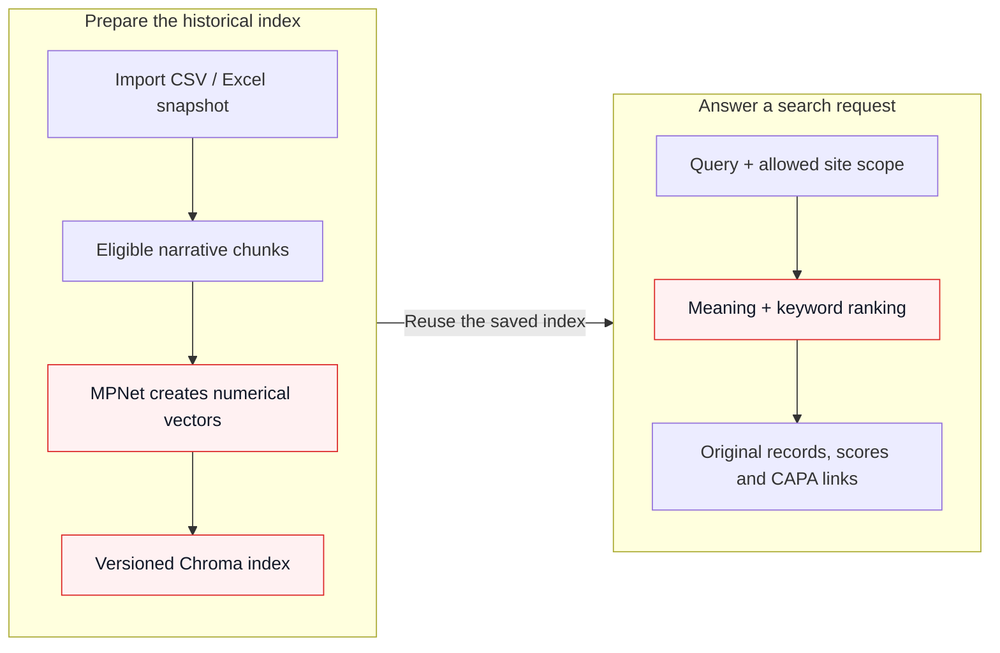

# CAPA.AI | MATCH backend

**Find historical deviations that resemble a new problem, with the source records available for inspection.**

MATCH is an independent FastAPI search service. It combines similarity in meaning with keyword overlap, respects the configured site scope, and returns ranked records with their original IDs and linked CAPAs. The embedding model runs locally; this service makes no OpenAI API calls.

A deviation is a recorded departure from an expected process. CAPA means corrective and preventive action.

| At a glance | Details |
|---|---|
| Runtime | Python 3.11, 64-bit; FastAPI |
| Local API | http://127.0.0.1:8102 |
| Interactive API docs | http://127.0.0.1:8102/docs |
| Docker image | `capa-ai-match:local` |
| Current integration | AUTHOR can call this API; common frontend MATCH screens are pending |

[Architecture](#how-match-works) / [Setup](#run-locally) / [Search](#try-a-search) / [Storage](#data-and-index-lifecycle) / [Troubleshooting](#troubleshooting) / [Deployment](#deployment)

## Where this fits

| Repository | Responsibility | Port |
|---|---|---|
| [MAP backend](https://github.com/rahul-jha-tfs/capa-ai-map-backend) | Group historical deviations into patterns | 8101 |
| **This repository: MATCH** | Retrieve similar historical records | 8102 |
| [AUTHOR backend](https://github.com/rahul-jha-tfs/capa-ai-author-backend) | Investigation drafting; optional MATCH search over HTTP | 8103 |
| [Common frontend](https://github.com/rahul-jha-tfs/capa-ai-frontend) | Browser interface; currently connected to MAP only | 8100 |

Services use copies of the same versioned CSV/XLSX export, imported into independent snapshots. They do not require sibling source folders, a shared Python package or a live TrackWise connection. Compare snapshot IDs when connecting services; importing new data into one service does not update the others automatically.

## How MATCH works

An **index** is a prepared, searchable representation of historical records. Build it when provisioning or changing source data; ordinary searches reuse it.



| Part | Current behavior | In plain terms |
|---|---|---|
| Embeddings | `sentence-transformers/all-mpnet-base-v2` | Compare the meaning of text |
| Runtime | ONNX FP32 by default | Run the model locally on CPU |
| Text preparation | Description and Conclusion separately; 500-character windows, 50-character overlap | Search long narratives while preserving field identity |
| Vector storage | Chroma with a versioned manifest | Reuse an index tied to its source |
| Ranking | 70% semantic + 20% BM25 + 10% Jaccard | Combine meaning with keyword relevance and word overlap |
| Site scope | One allowed site or all configured allowed sites | Keep retrieval within the chosen boundary |

Scores are ranking signals, not percentages of correctness. CAPA links come from source relationships. The local site allowlist is server configuration; enterprise user-based access control requires deployment configuration.

## Run locally

Use PowerShell from **this repository's root**. Choose Docker or native Python for a given port.

### Already configured on this machine

```powershell
# Docker Desktop must have its Linux engine running.
.\Start-Docker.ps1
```

Or use the repo's native environment:

```powershell
.\Start-Match.ps1
```

Keep the terminal open. Visit [API docs](http://127.0.0.1:8102/docs); stop with **Ctrl+C**. A cold start loads the index/model and can take a few minutes on this workstation.

### First setup on a new machine: native Python

Install Git, Git LFS and **Python 3.11, 64-bit**:

```powershell
git lfs install
git clone https://github.com/rahul-jha-tfs/capa-ai-match-backend.git
cd capa-ai-match-backend
git lfs pull
.\Setup-Match.ps1
```

Skip the clone steps if you already have the repo. Setup creates `.venv` and `.env`, installs pinned dependencies and imports the bundled source. For another workbook, use `Setup-Match.ps1 -Source "C:\data\export.xlsx" -Sheet "Sheet1"`.

Then prepare the real index:

1. Provision the MPNet cache under `data/models/huggingface`. For an initial download, set `HF_HUB_OFFLINE=0` and `TRANSFORMERS_OFFLINE=0` in local `.env`; return both to `1` after provisioning.
2. Build the index against the imported source:

```powershell
.\.venv\Scripts\python.exe -m capa_match.build
```

3. The builder writes the active index path, model and indexed site list into `.env`. Review `MATCH_ALLOWED_SITES_JSON` to expose only the intended indexed sites; an empty list grants no site access.
4. Run `Start-Match.ps1` and verify an actual search.

A clone includes the Git LFS source CSV. **The model cache, imported database and search index must be provisioned or built separately.** Index construction does not require an OpenAI key.

### First setup with Docker

Follow [DOCKER.md](DOCKER.md) for container-side source import, MPNet provisioning and index preparation. Create `.env.docker` from [docker.env.example](docker.env.example); paths inside the container use `/data/...`.

This workstation's separate copy at `data/match-index-linux` passed real Linux searches and restart checks. For another environment, validate a separate copy or build a compatible index there; copying an arbitrary Windows Chroma index is not proof of compatibility.

Once configured, use `Start-Docker.ps1`. Rebuild after code changes with:

```powershell
.\Start-Docker.ps1 -Build
```

The launcher publishes 8102 and mounts `data` at `/data`. Use `-Port 18102` for another host port and update callers accordingly.

## Configuration

Native Python reads `.env`; Docker reads `.env.docker`. Restart after changing settings or activating an index.

| Setting | Purpose |
|---|---|
| `CAPA_SOURCE_SNAPSHOT`, `CAPA_SOURCE_CSV` | Imported source version and matching export |
| `CAPA_DATA_DIR`, `CAPA_CACHE_DIR` | Service data and download/cache locations |
| `MATCH_INDEX_DIR` | Active directory containing `manifest.json` |
| `MATCH_MODEL_CACHE` | Hugging Face cache for MPNet |
| `MATCH_MODEL_NAME` | Checkpoint matching the index |
| `MATCH_ALLOWED_SITES_JSON` | JSON array of indexed sites the service may search |
| `HF_HUB_OFFLINE`, `TRANSFORMERS_OFFLINE` | Offline cache use after provisioning |

The index manifest's source snapshot ID must match the configured source. Missing or incompatible assets return an error instead of silently substituting demo results. Explicit mock embeddings exist for offline demonstrations and are labelled unsuitable for real search.

## Try a search

Check readiness and available sites:

```powershell
Invoke-RestMethod "http://127.0.0.1:8102/api/v1/match/index"
Invoke-RestMethod "http://127.0.0.1:8102/api/v1/match/sites"
```

Search all configured allowed sites:

```powershell
$body = @{
  query = "HPLC bracket standard failed system suitability"
  all_sites = $true
  top_k = 10
} | ConvertTo-Json

Invoke-RestMethod -Method Post `
  -Uri "http://127.0.0.1:8102/api/v1/match/search" `
  -ContentType "application/json" -Body $body
```

For one site, replace `all_sites` with `site = "<exact site from /sites>"`. `top_k` accepts 1-50. Results retain exact source IDs, matched field/text, component scores and linked CAPA metadata.

**Complete API inventory: 8 method-and-path operations, checked against this service's generated OpenAPI schema.** Each row links to its request parameters, response, saved changes and errors in the [detailed API reference](docs/API.md). GET and POST on the same URL count separately.

### Service and source APIs

| Method and path | Function |
|---|---|
| [`GET /api/v1/match/health`](docs/API.md#get-api-v1-match-health) | Check that the search API process responds. |
| [`GET /api/v1/match/ready`](docs/API.md#get-api-v1-match-ready) | Check the configured source snapshot. |
| [`GET /api/v1/match/capabilities`](docs/API.md#get-api-v1-match-capabilities) | Discover the service's declared feature flags. |
| [`GET /api/v1/match/source`](docs/API.md#get-api-v1-match-source) | Inspect source identity and row accounting. |

### Search and record inspection

| Method and path | Function |
|---|---|
| [`GET /api/v1/match/index`](docs/API.md#get-api-v1-match-index) | Check the loaded index, embedding configuration and searchable coverage. |
| [`GET /api/v1/match/sites`](docs/API.md#get-api-v1-match-sites) | List the configured sites that can be searched. |
| [`POST /api/v1/match/search`](docs/API.md#post-api-v1-match-search) | Find historical deviations similar to the query within the chosen site scope. |
| [`GET /api/v1/match/matched-records/{pr_id}`](docs/API.md#get-api-v1-match-matched-records-pr-id) | Inspect a complete indexed record within an allowed site. |

Use `/docs` for interactive requests and `/openapi.json` for the schema. MATCH deliberately has no unscoped source-record browsing route.

### Connect AUTHOR

AUTHOR calls MATCH over HTTP rather than importing its Python code:

- Native services: AUTHOR uses `MATCH_API_URL=http://127.0.0.1:8102`.
- Both Docker launchers: AUTHOR uses `MATCH_API_URL=http://capa-ai-match:8102` on their shared `capa-ai` network.
- The common frontend currently has no MATCH screens or MATCH proxy.

## Data and index lifecycle

The reference workstation has **19,643 accepted source records**. Its MATCH index contains **4,292 eligible deviations**, **24,440 chunks**, across **25 sites**. These are coverage figures for that source/index, not fixed application limits. See [source provenance](data/sources/README.md).

| Location | Contents | In Git? |
|---|---|---|
| `data/sources/trackwise_records.csv` | Shared named source export | Yes, Git LFS |
| `data/sources/<snapshot-id>.*` | Generated source snapshot/export | No |
| `MATCH_INDEX_DIR` | Manifest and its index generations | No |
| `data/models/huggingface/` | MPNet cache | No |
| `.local/` | Verification and deployment staging | No |

To change the source: import it, build its index, review site access and restart. Use `python -m capa_match.build --help` from the installed environment for build options. `--rebuild` publishes a new generation while retaining old files. Do not rebuild/replace an active index while a server is using it.

## Find your way around

```text
src/capa_match/             Service API, source identity, configuration and builder
  infrastructure/          Source import, storage and HTTP boundary
src/match_v1/              Retained MPNet/Chroma and hybrid retrieval engine
scripts/verify_local.py     Real index/search/API smoke checks
scripts/prepare_deployment.py  Code-only deployment staging
tests/                     Offline and optional real-model checks
Start-Match.ps1             Native launcher
Start-Docker.ps1            Independent Docker launcher
```

## Verify your setup

```powershell
.\.venv\Scripts\python.exe -m pytest -q
.\.venv\Scripts\python.exe -m pip check
# Start MATCH first; uses a real model/index, with no OpenAI calls:
.\.venv\Scripts\python.exe scripts/verify_local.py
```

Set `MATCH_RUN_INTEGRATION=1` to enable the optional heavier integration suite. [VERIFICATION.md](VERIFICATION.md) records offline checks, Linux index loading, real search, restart behavior and the AUTHOR connection. [FEATURE_PARITY.md](FEATURE_PARITY.md) describes retained behavior. These checks do not establish retrieval accuracy.

## Troubleshooting

| Symptom | Check |
|---|---|
| API alive but `/index` returns 503 | Index path, model cache, source identity and logs; health alone does not validate search |
| HTTP 403 for a site | Use an indexed site allowed by `MATCH_ALLOWED_SITES_JSON`; all-sites still obeys it |
| Source/index mismatch | Rebuild against the configured source; do not edit the manifest to bypass the check |
| Offline model load fails | Provision the MPNet cache and required runtime assets |
| Slow first request | Allow index/model loading; subsequent calls reuse them |
| AUTHOR cannot reach Docker MATCH | Use `capa-ai-match:8102` on their network, not `localhost` inside AUTHOR |
| CSV is an LFS pointer | Run `git lfs pull` before import |

## Deployment

[DOCKER.md](DOCKER.md) covers the image, mounted data and checks. [DEPLOYMENT.md](DEPLOYMENT.md) covers Databricks Apps, code-only staging, published source/model/index assets, app permissions and authentication.

Linux Docker retrieval is verified locally; Databricks deployment remains a separate acceptance step. Keep published generations immutable, give serving processes separate writable caches, and validate real retrieval in the target environment. Enterprise identity/site authorization belongs at the service boundary.
